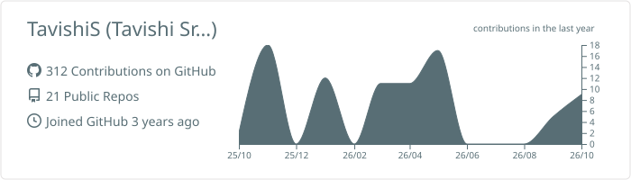
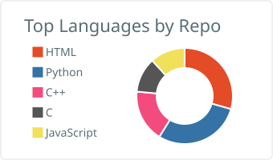
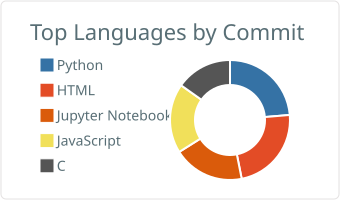
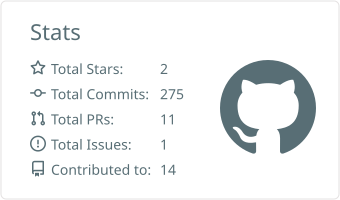

<h1 align="center">
  
</h1>
<h3 align="center">🎓 3rd Year CSE @ IIT Jodhpur | 💻 Web Dev & Coding Enthusiast | 🎶 Music Lover</h3>

  

---

### 🌸 About Me

- 🎓 B.Tech CSE @ **IIT Jodhpur** (2023–Present)
- 💻 Passionate about **web development**, especially with Django, Flask & React
- 💡 I enjoy solving problems using **C++** and **Python**
- ☁️ Deployed websites using **Render**
- 💽 Experienced with **MySQL**, **MongoDB**, and **MongoDB Atlas**
- 🎤 **Singer** at heart — member of **Sangam**, IITJ’s Music Society
- 🏆 Performed at **Ignus**, **Spandan**, **Prometeo**, and **Inter-IIT Cultural Meet (2024)**

---

### 💻 Skills & Technologies

#### 🚀 Programming & Development
- **Languages:** C++, Python, JavaScript  
- **Frontend:** HTML, CSS, JavaScript, React.js  
- **Backend:** Django, Flask  
- **Databases:** MySQL, MongoDB, MongoDB Atlas  
- **Tools & Platforms:** GitHub, Google Colab, Render  

  

---

### 🎓 Education

- 🏫 **Indian Institute of Technology (IIT) Jodhpur**  
  B.Tech in Computer Science and Engineering (2023 - Present)  
  - Core subjects and skills learnt: DSA, Software Engineering, Web Development, and still counting...  
  - Learnt teamwork, communication & socialising skills.

- 🏫 **Girls' High School & College, Prayagraj**  
  - Class 10 (ICSE): 97% | 💯 in Computer Science.
  - Class 12 (ISC): 99.5% | 💯 in Computer Science, Maths, Chemistry.
  - 🏅 Felicitated by **CM Yogi Adityanath Ji** for securing **AIR 2** in my ISC Class 12th Board Examinations.

---

### 📂 Projects

| Project | Description | Link |
|--------|-------------|------|
| 🎬 MoodFlix | Recommends movies based on user’s mood (text/voice/form input) | [Repo](https://github.com/TavishiS/Emotion2Movies) |
| ✅ ToDo App | Multi-user task manager with CRUD features & signup/login functionality | [Repo](https://github.com/TavishiS/ToDo-app) |
| 🧠 Face Identification | ML-based face identification on LFW dataset using traditional classification techniques such as, Decision Tree, KNN, Naive Bayes, ANN, Random Forest, etc. | [Repo](https://github.com/AgarwalMayank2/Face_Identification) |
| 👩‍🎓 Student Manager | C-based Student Record Manager using File Handling | [Repo](https://github.com/TavishiS/Student_Management_System) |
| 🧩 Quiz Game | 3-level quiz (easy, medium and hard) with live feedback on chosen answers | [Repo](https://github.com/TavishiS/Quiz_Game) |

---

### 🌐 Contact Me

- 📧 Email: [tavishi.srivastava2004@gmail.com](mailto:tavishi.srivastava2004@gmail.com)  
- 🔗 [LinkedIn](https://www.linkedin.com/in/tavishi2004/)  
- 🪪 [Portfolio](https://tavishis.github.io/Tavishi_Portfolio/)

---

### 📈 GitHub Stats

  
  

---

### 🎵 Fun Fact

> 

  

  
  

---

### My GitHub Stats

<table>
  <tr>
    <td></td>
    <td></td>
  </tr>
  <tr>
    <td></td>
    <td></td>
  </tr>
</table>

<!-- This includes the radar chart -->

---

⭐️ *Thank you for visiting my profile! Feel free to connect, collaborate or just say hi!* 🤝
